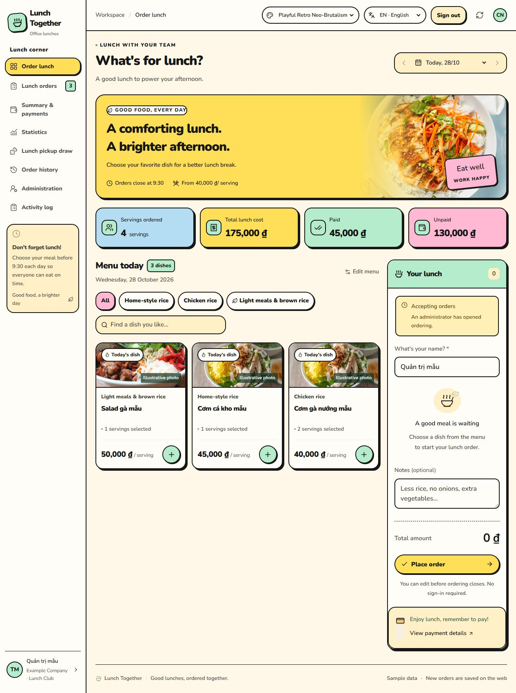
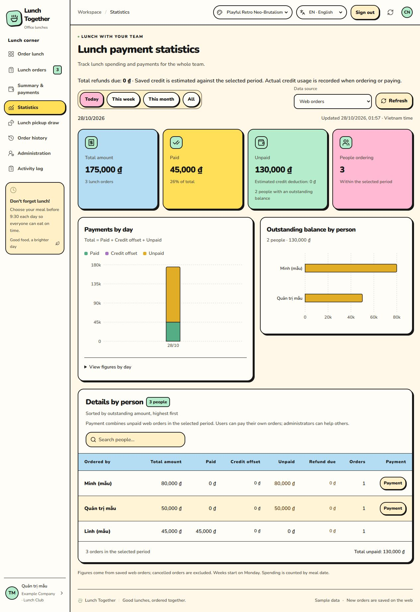

# Lunch Together · Office lunch coordination

[English](README.md) · [Tiếng Việt](README.vi.md)

Lunch Together helps a team order lunch together, track who has paid, and share the job of collecting meals. The app is called **Cơm Nhà** in Vietnamese. People can order as guests or sign in with Google. The interface defaults to **Vietnamese**, with **English** available from the VI/EN selector.

This is an early-stage, MIT-licensed application maintained by [devoralabsapp](https://github.com/devoralabsapp). Contributions, bug reports, and translations are welcome. The public repository contains application source and sample data; each operator supplies their own Firebase project and deployment configuration.



*Current English interface in the optional **Playful Retro Neo-Brutalism** theme, captured from the application with fictitious orders in local Firebase emulators. Vietnamese remains the default language; choose this theme from the theme selector.*

<details>
<summary>Payment statistics in the Retro theme</summary>



</details>

## What it does

- **Profiles, companies and departments:** edit personal details and affiliation, manage the company directory, and export/import personal JSON backups with financial records retained for administrator review.

- **Daily menus and orders:** add multiple dishes to one cart, set quantities and notes; remember a guest's name on that browser; edit or cancel your own orders before closing.
- **Optional Google sign-in:** guest ordering uses Firebase Anonymous Authentication. Linking Google supports continued access across devices.
- **Shared visibility:** everyone can see team orders and statistics. Ownership and administrator permissions control changes.
- **Administration:** publish menus, open or close ordering, export PDF/JPG and revocable restaurant links, manage booking access, assign administrator roles through the primary administrator, and inspect activity history.
- **Payment tracking:** totals, paid and unpaid amounts, charts over time, and balances per person, with today/week/month/all-time filters. Web orders are the default source.
- **Fair pickup draws:** select 1–10 people, defaulting to two. People with fewer selections that week have priority; equal-priority participants are chosen randomly. Results are saved once per day.
- **VietQR transfers:** administrators configure the receiving bank account; QR codes are generated locally for one order or several days, with the exact remaining amount and a unique reference.
- **Paid edits and refunds:** preserve money received after changing or cancelling meals; collect only the difference, request an actual refund, or keep surplus as credit for later orders. Credit use and manual adjustments retain immutable ledgers.
- **Optional payment automation:** a secret-protected API accepts raw BIDV or Techcombank notifications forwarded by an administrator's device. Matching notifications settle existing orders through Firestore Rules; optional redacted Telegram logs help operations.
- **Vietnamese and English UI:** the browser remembers the selected language. User names, dish names, notes, and transfer references retain their original values.

## Run locally

Requirements: **Node.js 22**, npm, and a Firebase project with **Cloud Firestore Standard**. **Java 21** is needed for emulator tests.

```sh
git clone https://github.com/devoralabsapp/lunch-together.git
cd lunch-together
npm ci --include=dev --include=optional
cp .env.example .env.local
```

Fill in the Firebase Web configuration in `.env.local`, enable Google and Anonymous sign-in, and configure the initial administrator and Firestore Rules. Follow the [English setup guide](docs/setup.md) before accepting orders.

```sh
npm run dev
```

Open [localhost:5173](http://localhost:5173). An administrator must publish the day's menu before guests can place orders. On PowerShell, `Copy-Item .env.example .env.local` also works.

## Architecture and permissions

The app uses **Next.js 16, React 19, TypeScript, Firebase Authentication, and Firestore Standard**, with Vercel configuration included. Browsers access Firestore with the Web SDK; **Security Rules enforce authorization and order validation**. The application does not require a service-account key, Firebase Admin SDK, or Vercel OIDC.

Orders live under `days/{dayId}/orders/{orderId}`. Team order information is publicly readable by design; profiles and emails have narrower access. Guest ownership belongs to the anonymous Firebase session stored in that browser. Clearing browser data loses that guest's editing identity. Administrators remain trusted operators.

The optional payment API exchanges a dedicated integration's refresh token for a Firebase ID token and performs restricted writes under the same Rules. Forwarded device notifications are **not signed bank webhooks**: anyone holding the webhook secret can submit text. See the [payment integration guide](docs/payment-integration.md) for matching, replay handling, and limitations.

Pickup fairness applies to people present on each day's participant list. For an unchanged participant group, weekly selection counts differ by at most one. Rules protect the draw's permissions and immutability; the trusted administrator's client performs the selection algorithm.

## Validation

```sh
npm run build
npm run typecheck
npm test
```

Tests use local Firebase Auth and Firestore emulators with a `demo-` project, not a live database. They cover ordering, ownership, account linking, administrator permissions, payment matching, duplicate notifications, statistics, pickup fairness, and localization. GitHub Actions runs the same checks on pull requests using Node.js 22 and Java 21.

## Documentation and contributing

- [Setup and Vercel deployment](docs/setup.md) — English
- [Payment integration and Telegram logs](docs/payment-integration.md) — English
- [Multiple dishes, payment differences, refunds and restaurant sharing](docs/orders-payments-sharing.md) — English / Tiếng Việt
- [Carryover credit and activity history](docs/credit-and-activity.md) — English / Tiếng Việt
- [Localization guide](docs/localization.md) — English
- [Detailed application and operations guide](README.vi.md) — Tiếng Việt
- [Firebase/Vercel deployment notes](docs/deploy-vercel.md) — Tiếng Việt
- [Bank notification API](docs/bank-payments.md) and [Telegram setup](docs/telegram-payment-logs.md) — Tiếng Việt
- [Contributing](CONTRIBUTING.md), [security reporting](SECURITY.md), and [MIT license](LICENSE)

Development has been assisted by OpenAI Codex. Changes still require maintainer review and automated validation. Current contribution areas include translation quality, accessible mobile layouts, emulator-based regression coverage, and clearer self-hosting documentation. The repository does not claim program sponsorship or endorsement.

## License and acknowledgements

Original application code is available under the [MIT license](LICENSE). Dependencies retain their own licenses. External food photographs are illustrative assets linked from HelloFresh, feedthepudge, and Saigon Sisters; their respective owners retain rights. Replace them with your own or appropriately licensed images for your deployment.

- [Order-list totals, personal grouped payment and reconciliation privacy](docs/order-list-payments.md) — English / Tiếng Việt

- [Personal activity history, access rules and index setup](docs/activity-history.md) — English / Tiếng Việt

- [Personal profiles, companies/departments and JSON backup/restore](docs/personal-data-and-departments.md) — English / Tiếng Việt
