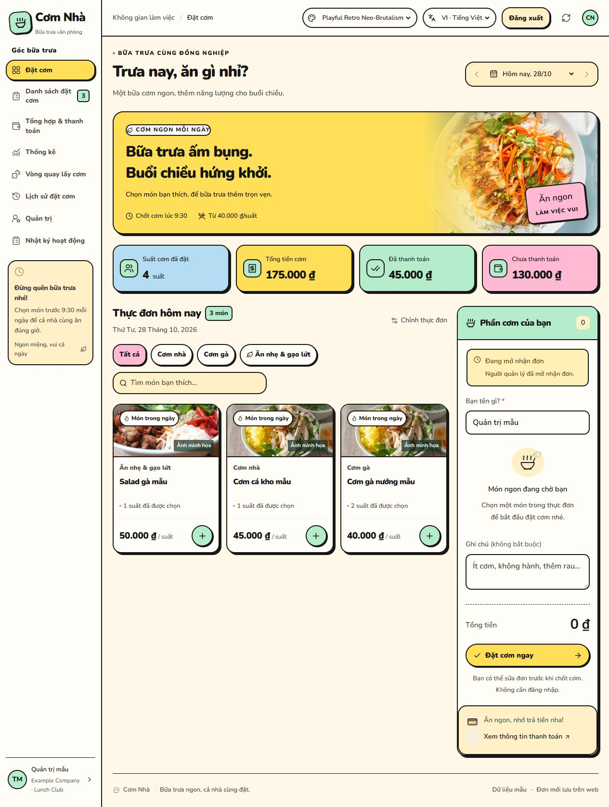
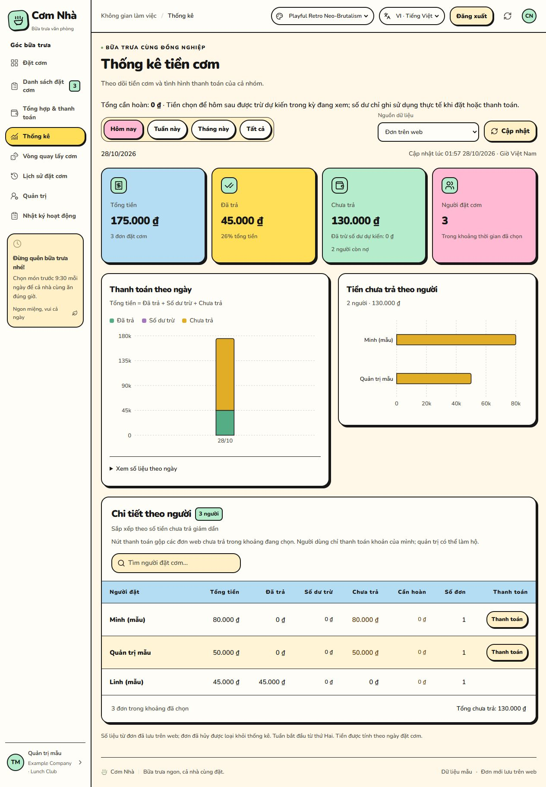

# Cơm Nhà · Lunch Together

[English](README.md) · [Tiếng Việt](README.vi.md)

**Lunch Together** là tên tiếng Anh của ứng dụng Cơm Nhà — cùng đặt bữa trưa, theo dõi thanh toán và chia sẻ việc lấy cơm trong nhóm. Repo mã nguồn: [devoralabsapp/lunch-together](https://github.com/devoralabsapp/lunch-together). Giao diện mặc định vẫn là tiếng Việt.

Bản mã nguồn công khai để bàn giao vận hành và phát triển. Xem **[Hướng dẫn bàn giao](docs/handover.md)** trước khi kết nối Firebase/Vercel. Repo dùng cấu hình mẫu, không chứa dữ liệu hoặc lịch sử Git của hệ thống đang chạy.

Web Next.js 16, React 19, Firebase Authentication và Cloud Firestore Standard. Vercel phục vụ giao diện; trình duyệt đọc/ghi bằng Firebase Web SDK và Firestore Security Rules. Quyền đọc dữ liệu đặt cơm dùng chung cho cả nhóm; quyền ghi tách theo chủ đơn và quản trị viên.



*Giao diện hiện tại với theme **Playful Retro Neo-Brutalism**, chụp trực tiếp từ ứng dụng bằng dữ liệu giả trên Firebase Emulator cục bộ. Chọn theme này ở bộ chọn giao diện; ngôn ngữ mặc định vẫn là tiếng Việt.*

<details>
<summary>Xem thống kê với giao diện Retro</summary>



</details>

## Tính năng

- Hồ sơ cá nhân, công ty/phòng ban linh hoạt và xuất/nhập JSON của chính tài khoản; dữ liệu tiền giữ lại để quản trị đối soát.

- Giao diện mặc định **tiếng Việt**; đổi sang **tiếng Anh** bằng bộ chọn VI/EN ở đầu trang. Trình duyệt nhớ lựa chọn khi tải lại. Tên, món ăn, ghi chú và mã chuyển khoản giữ nguyên.

- Khách đặt/sửa/hủy cơm mà không cần bấm đăng nhập. Firebase tự tạo tài khoản ẩn danh để nhận diện chủ đơn.
- Google tùy chọn; đơn được giữ khi liên kết tài khoản và dùng được trên nhiều thiết bị.
- Quản trị viên chỉnh thực đơn, tạo ngày, chốt/mở nhận đơn, xác nhận thanh toán và xuất CSV.
- Mục **Quản trị người dùng** chỉ xuất hiện với quản trị viên: tìm tên/email/UID, xem tài khoản Google và phiên khách, khóa/mở quyền đặt cơm. Quản trị chính cấp/thu hồi quyền quản trị cho người đã đăng nhập Google.
- Tên của khách được nhớ trên trình duyệt sau khi đặt thành công và tự điền ở lần sau; sửa đơn hộ người khác không đổi tên đã nhớ của người quản trị.
- Quản trị nhập ngân hàng, số tài khoản và tên người nhận trên web. Khách tạo QR theo đúng số tiền và mã đơn; QR được dựng cục bộ trong trình duyệt.
- [API nhận thông báo BIDV / Techcombank từ Shortcut](docs/bank-payments.md) đối chiếu mã đơn, tiền vào, tài khoản, thời điểm và phiên bản đơn trước khi tích đã trả; chống gửi lặp bằng biên nhận bất biến. API dùng hai biến máy chủ riêng và danh tính Firebase giới hạn quyền, không dùng OIDC hoặc service account key.
- Giá, quyền sở hữu, số lượng, giờ chốt 9:30 Việt Nam và thanh toán được kiểm tra trong Rules.
- Mỗi đơn là một document riêng. Mọi người, gồm khách không đăng nhập Google, được xem toàn bộ đơn và thống kê. Khách chỉ sửa/hủy đơn của mình; chỉ quản trị viên xác nhận thanh toán và quản lý thực đơn.
- Mục **Thống kê** có tổng tiền, đã trả, chưa trả; biểu đồ theo thời gian và người còn nợ. Lọc **Hôm nay / Tuần này / Tháng này / Tất cả**, theo giờ Việt Nam và tuần bắt đầu thứ Hai.
- **Vòng quay lấy cơm** chọn 1–10 người (mặc định 2) từ các đơn web trong ngày đang chọn. Ưu tiên người có ít lượt nhất trong tuần, chọn ngẫu nhiên giữa những người ngang lượt; một tên chỉ chiếm một chỗ dù đặt nhiều suất.

## Thiết lập

Xem [hướng dẫn Firebase + Vercel](docs/deploy-vercel.md). Chỉ cần Firebase Web config, bật Google + Anonymous, Publish Rules và tạo bản ghi quản trị theo UID. Không cần OIDC, service account key, Cloud Shell, AUTH_SECRET hoặc backend Admin SDK.

```text
npm ci --include=dev --include=optional
npm run dev
```

Dùng Node.js 22, sao chép `.env.example` thành `.env.local` và điền Web config. Mở [localhost:5173](http://localhost:5173). Sau khi quản trị viên lưu thực đơn lần đầu, khách có thể đặt cơm.

## Dữ liệu và quyền

Schema mới: `days/{dayId}`, subcollections `dishes/{dishId}` và `orders/{orderId}`. Quản trị đầu tiên được cấp qua Firebase Console trong `admins/{uid}`. Quản trị cần Google đã xác minh và `enabled: true`. Chỉ quản trị chính được cấu hình thay cho `PRIMARY_ADMIN_UID_HERE` trong cả `lib/user-model.ts` và `firestore.rules` được cấp/thu hồi vai trò của người khác trên web; không thể tự thu hồi quyền hay khóa chính mình. Quản trị khác được xem danh sách và khóa/mở đặt cơm của người dùng thông thường.

`userProfiles/{uid}` giữ tên hiển thị/tên đặt cơm, email từ token Google, loại đăng nhập và thời điểm ghé web; chỉ chính chủ và quản trị viên đọc được, chỉ chính chủ ghi đúng schema. `userAccess/{uid}` giữ trạng thái khóa đặt cơm và người/thời điểm cập nhật. Vai trò nằm riêng trong `admins`, không lấy từ tên hoặc hồ sơ tự khai. Mỗi UID là một danh tính; nhiều tên trùng nhau không gộp tài khoản. Người cũ vẫn xuất hiện từ chủ đơn trong lịch sử, hồ sơ/email chỉ được bổ sung khi quay lại web. Danh sách này không phải toàn bộ tài khoản trong Firebase Authentication.

Khóa đặt cơm ngăn UID tạo/sửa đơn, vẫn cho đọc và hủy đơn của mình trước khi chốt; không xóa dữ liệu và không vô hiệu hóa Firebase Auth. Khách có thể có UID mới nếu xóa dữ liệu trình duyệt. Người đang có quyền quản trị phải được quản trị chính thu hồi quyền trước khi khóa đặt cơm. Các thay đổi vai trò/trạng thái được kiểm tra lại trong Rules, kể cả khi gửi cùng batch; giao diện có bước xác nhận.

Tên khách dùng khóa trình duyệt `com-nha:name:v1`, chuẩn hóa NFC, bỏ khoảng trắng hai đầu và tối đa 100 ký tự. Chỉ lưu sau khi giao dịch đơn của chính người dùng đã commit, trước bước tải dữ liệu lại; lỗi đọc lại/đồng bộ hồ sơ không làm mất tên đã nhớ. Không ghi vào bộ nhớ trình duyệt khi quản trị sửa đơn của người khác. Chế độ chặn lưu trữ/xóa dữ liệu trình duyệt có thể làm mất tên tự điền; việc đặt cơm không phụ thuộc vào lưu tên.

Tên người đặt được băm SHA-256 sau khi chuyển chữ thường để tạo ID đơn duy nhất trong ngày. Tên bất biến; đổi tên hoặc dùng lại tên đã thuộc người khác cần liên hệ quản trị viên. Đơn hủy vẫn được giữ và chính chủ có thể đặt lại trước giờ chốt. Tên nhập trên giao diện được chuẩn hóa Unicode NFC và bỏ khoảng trắng hai đầu.

Phiên khách được Firebase lưu trong trình duyệt. Xóa dữ liệu trình duyệt sẽ mất quyền sửa/hủy đơn khách; các đơn vẫn xem được trong danh sách chung. Google mới liên kết trực tiếp giữ UID cũ; Google đã tồn tại nhận đơn qua vé chuyển quyền do chính phiên khách cấp, giới hạn tối đa 10 phút. Chuyển quyền chỉ đổi ownerId/updatedAt và không đổi giá, thanh toán hay nội dung đơn. Nếu việc chuyển gặp lỗi, tải lại trang để thử tiếp; quá hạn cần quản trị viên hỗ trợ.

Dữ liệu schema cũ `mealDays`/`mealOrders` và cookie máy chủ cũ không tự chuyển sang quyền Firebase UID. Rules giữ chúng ở chế độ từ chối truy cập. Dữ liệu vẫn còn trên Firestore; việc nhập/mapping lịch sử cần xử lý riêng. Không tự tải dữ liệu thật từ Google Sheets hoặc file cục bộ lên cloud.

Repository chỉ có một ngày mẫu. File `data/source.json` riêng tại máy chỉ được dùng làm mẫu thực đơn công khai; mọi đơn, danh sách người đặt và URL Sheets đều được loại khỏi dữ liệu gửi tới trình duyệt. Dữ liệu thật, QR và `.env.local` không lên Git/Vercel. Tài khoản nhận tiền được quản trị cấu hình trên web trong `settings/payment`; QR ảnh cũ vẫn tương thích. Xem [QR và API thông báo BIDV / Techcombank](docs/bank-payments.md) để bật tự đối chiếu, cần hai biến máy chủ riêng và Rules mới. URL QR cục bộ cũ trả 410.

Thống kê mặc định dùng **đơn trên web** cho cả khách và quản trị viên. Mọi người cùng xem số liệu của cả nhóm, có thể chọn thêm Google Sheets (dữ liệu cũ) hoặc cả hai. Chỉ tải Sheets khi chọn nguồn có Sheets; nút **Cập nhật** đọc lại nguồn đang chọn. Khi đọc workbook, web tính tiền từng dòng theo ô đã trả, kể cả sheet ẩn; dòng thiếu giá/trạng thái được cảnh báo. Khi kết hợp, đơn web cùng ngày, tên và bữa ăn thay thế dòng Sheets để tránh đếm hai lần. Nhóm “Chưa ghi tên” là các đơn chưa xác định được người đặt.

Endpoint `/api/statistics/sheets` kiểm tra Firebase ID token bằng Auth REST trước khi tải Sheets; phiên khách ẩn danh cũng được đọc dữ liệu. Mọi phản hồi đều `private, no-store`. Không cần OIDC hoặc private key. Cần Publish bản `firestore.rules` mới để mọi người truy vấn toàn bộ đơn web; quyền sửa/hủy vẫn kiểm tra chủ đơn và quyền quản trị. Nguồn Sheets là tùy chọn và không có ID mặc định trong repo public. Để trống `MEAL_SPREADSHEET_ID` nếu chỉ dùng dữ liệu Web. Nguồn Sheets phải cho phép tải qua đường dẫn đã cấu hình; nếu bị hạn chế, web báo lỗi thay vì hiển thị tổng thiếu. Có thể đổi nguồn bằng biến máy chủ `MEAL_SPREADSHEET_ID` và năm đầu workbook bằng `MEAL_SHEETS_START_YEAR` (mặc định 2025).

## Vòng quay lấy cơm

Mọi người xem được danh sách tham gia, kết quả và lịch sử tuần; chỉ quản trị viên quay cho hôm nay theo giờ Việt Nam. Nút **Chốt danh sách & quay** đóng nhận đơn trước khi đọc danh sách để giữ cố định người tham gia. Nếu đã chốt, nút hiển thị **Quay chọn người**. Chỉ lưu kết quả sau khi chốt thành công; nếu bước chọn thất bại, ngày vẫn được chốt và có thể cập nhật/quay lại khi chưa có kết quả.

Mỗi ngày có một document bất biến `pickupDraws/{YYYY-MM-DD}`, dùng chung cho các đợt đặt cơm cùng ngày. Giao dịch đọc lịch sử cả tuần và kiểm tra lại phiên bản ngày cùng các đơn trước khi lưu. Hai lượt quay đồng thời nhận cùng một kết quả; tải lại hoặc rời trang khi đang chạy hiệu ứng không tạo thêm lượt. Kết quả được lưu trước khi hoạt ảnh công bố từng tên.

Thuật toán luôn chọn người có số lượt thấp nhất trong nhóm có mặt, rồi dùng Web Crypto bốc ngẫu nhiên khi bằng lượt. Với cùng một danh sách tham gia mỗi ngày, chênh lệch số lượt trong tuần tối đa 1. Khi người tham gia thay đổi, chỉ cân bằng trong số người có đơn của đợt đó. Lịch sử bắt đầu từ khi dùng tính năng, tính theo tên đã chuẩn hóa và tuần thứ Hai–Chủ nhật; tên khác nhau được tính thành người khác nhau. Số lượt là số lần được chọn, không phải xác nhận đã đi lấy cơm thực tế.

Rules kiểm tra quyền quản trị, ngày hiện tại theo giờ máy chủ, thứ Hai đầu tuần, cấu trúc/giới hạn danh sách và chặn ghi đè/xóa kết quả. Quản trị viên được tin cậy để thực hiện thuật toán trên ứng dụng; Rules không tự tính lại thứ tự ưu tiên/ngẫu nhiên. Cần Publish **toàn bộ file Rules mới nhất**, gồm `pickupDraws`, trước khi phát hành bản có vòng quay.

## Kiểm thử

```text
npm run build
npm run typecheck
npm test
```

`npm test` tự chạy Firebase Auth/Firestore Emulator ở project `demo-datcom-tests`, cần Java 21. Bài thử dùng Web SDK thật để đặt/sửa/hủy, liên kết Google, kiểm tra giao dịch đặt trùng và tấn công trực tiếp Rules; không dùng private key hay project thật. GitHub Actions chạy Node.js 22 + Java 21. [Báo cáo Rules](docs/firestore-rules-review.json) ghi phạm vi và giới hạn kiểm tra.

Ảnh món là minh họa từ HelloFresh, feedthepudge và Saigon Sisters.

## Nguồn mở và đóng góp

Mã nguồn ứng dụng được phát hành theo [giấy phép MIT](LICENSE). Xem [hướng dẫn đóng góp](CONTRIBUTING.md), [báo lỗi bảo mật](SECURITY.md), [cài đặt bằng tiếng Anh](docs/setup.md) và [hướng dẫn dịch giao diện](docs/localization.md). Ảnh minh họa bên ngoài và thư viện phụ thuộc giữ giấy phép/quyền riêng của chủ sở hữu.

## Đặt nhiều món, thanh toán chênh lệch và gửi nhà hàng

Xem [hướng dẫn nhiều món, thanh toán gộp, hoàn tiền và chia sẻ](docs/orders-payments-sharing.md). Phần Tổng hợp & thanh toán xuất PDF/JPG thay CSV, quản trị tạo link gửi nhà hàng dùng 7 ngày. Đơn đã trả giữ tiền khi sửa/hủy; chỉ thu phần thiếu hoặc ghi cần hoàn, quản trị xác nhận sau khi hoàn thực tế. Publish toàn bộ Rules mới trước khi triển khai.

## Số dư dùng lần sau và nhật ký hoạt động

Người đặt chọn Hoàn lại hoặc Để hôm sau khi có tiền thừa. Số dư gắn theo tài khoản/phiên khách, tự trừ khi đặt hoặc thanh toán; thống kê hiện Số dư trừ riêng. Quản trị xem toàn bộ Nhật ký hoạt động; người dùng thường mở Nhật ký của tôi để xem các hoạt động của chính tài khoản. Xem [hướng dẫn số dư và nhật ký](docs/credit-and-activity.md) để biết cách đối soát, phạm vi log và những trường hợp không tự ghi nhận.

Chi tiết tổng theo bộ lọc, nút thanh toán gộp trong Đơn của tôi và quyền xem lịch sử đối soát: [hướng dẫn danh sách và thanh toán](docs/order-list-payments.md).

Nhật ký cá nhân cần Publish Rules và tạo chỉ mục theo [hướng dẫn nhật ký](docs/activity-history.md).

- [Hồ sơ cá nhân, công ty/phòng ban và sao lưu/khôi phục JSON](docs/personal-data-and-departments.md) — English / Tiếng Việt
